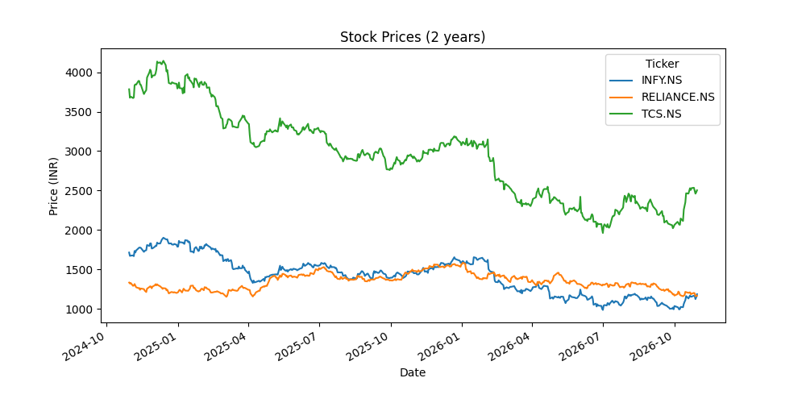
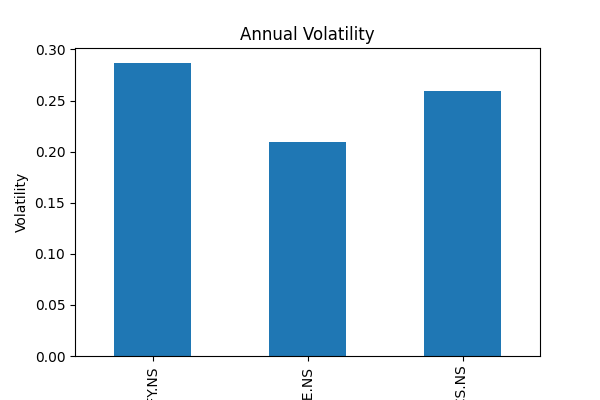
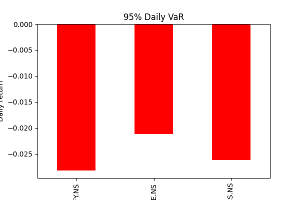

# Stock Risk Analyzer

A Python tool that downloads two years of daily price data for NSE stocks (Reliance, TCS, Infosys) and measures how risky each one is.

## What it calculates

- **Daily returns:** percentage change in closing price from one day to the next
- **Volatility:** standard deviation of daily returns, also annualised using the square root of 252 trading days
- **Value at Risk (VaR, 95%):** the 5th percentile of daily returns, i.e. the loss that was exceeded only on the worst 5% of days
- **Maximum drawdown:** the largest fall from a previous peak
- **Correlation:** how closely the stocks move together

## Tech stack

Python, pandas, NumPy, Matplotlib, yfinance

## How to run

```
pip3 install -r requirements.txt
python3 risk_analyzer.py
```

The script prints the metrics in the terminal and saves charts as `prices.png`, `volatility.png` and `var.png`.

## Charts





## Notes and limitations

- VaR here is **historical**: it assumes the future will look like the last two years.
- Data comes from Yahoo Finance through `yfinance`, so numbers change depending on the date you run it.
- To analyse other stocks, change the `stocks` list at the top of the script (NSE tickers end with `.NS`).
